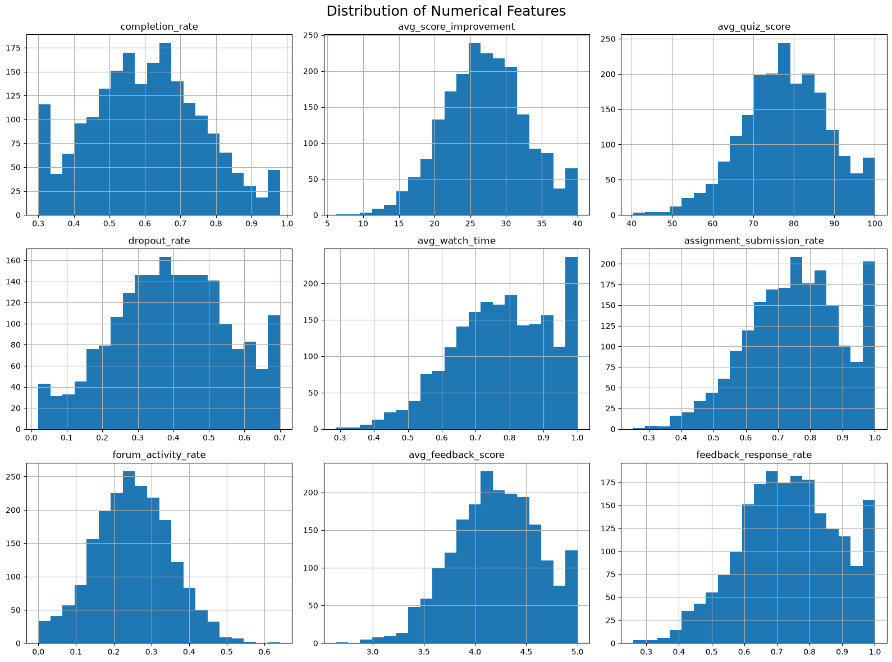
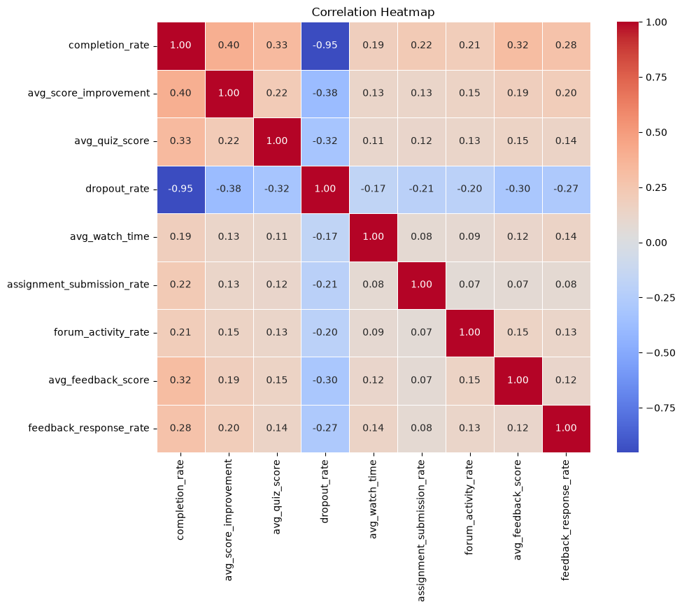
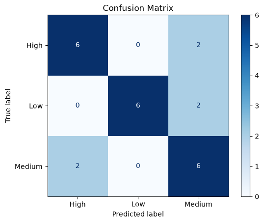
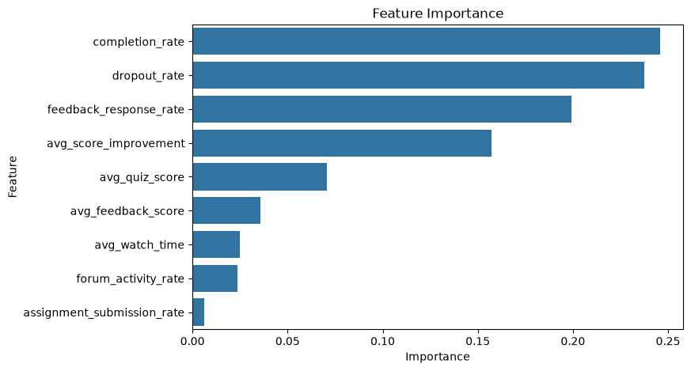

# 🎓 Instructor Effectiveness Prediction using Machine Learning

<p align="center">


</p>

---

## 📖 Project Overview

Educational platforms collect large amounts of learner data, but evaluating instructor performance objectively remains challenging.

This project develops a **Machine Learning pipeline** to predict **Instructor Effectiveness** by analyzing learner performance, engagement, and feedback metrics.

The project follows a complete **Data Science workflow**, including:

- Data Cleaning
- Exploratory Data Analysis (EDA)
- Feature Engineering
- Feature Scaling
- Instructor-Level Aggregation
- Machine Learning
- Model Evaluation
- Business Insights

---

# 📚 Table of Contents

- [Problem Statement](#-problem-statement)
- [Dataset](#-dataset)
- [Project Workflow](#-project-workflow)
- [Exploratory Data Analysis](#-exploratory-data-analysis)
- [Feature Engineering](#-feature-engineering)
- [Machine Learning](#-machine-learning)
- [Results](#-results)
- [Feature Importance](#-feature-importance)
- [Project Structure](#-project-structure)
- [Installation](#-installation)
- [Future Improvements](#-future-improvements)
- [Author](#-author)

---

# 🎯 Problem Statement

The objective of this project is to identify the effectiveness level of instructors using learner-related performance metrics.

The workflow includes:

- Understanding learner behaviour
- Measuring instructor performance
- Engineering a business-driven effectiveness score
- Predicting instructor effectiveness using Machine Learning

---

# 📊 Dataset

### Dataset Summary

| Property | Value |
|----------|-------|
| Records | **2000** |
| Instructors | **120** |
| Courses | **25** |
| Features | **12** |

### Features

- Completion Rate
- Average Score Improvement
- Average Quiz Score
- Dropout Rate
- Average Watch Time
- Assignment Submission Rate
- Forum Activity Rate
- Average Feedback Score
- Feedback Response Rate

---

# 🔄 Project Workflow

```
Raw Dataset
      │
      ▼
Data Cleaning
      │
      ▼
Exploratory Data Analysis
      │
      ▼
Instructor-Level Aggregation
      │
      ▼
Feature Scaling
      │
      ▼
Feature Engineering
      │
      ▼
Instructor Effectiveness Score
      │
      ▼
Low / Medium / High Labels
      │
      ▼
Random Forest Classifier
      │
      ▼
Model Evaluation
      │
      ▼
Feature Importance
```

---

# 📈 Exploratory Data Analysis

The following analyses were performed:

- ✅ Dataset Inspection
- ✅ Missing Value Analysis
- ✅ Duplicate Check
- ✅ Histograms
- ✅ Correlation Heatmap
- ✅ Outlier Detection

---

## 📷 Distribution of Numerical Features



---

## 🔥 Correlation Heatmap



### Key Insight

- Strong negative correlation between **Completion Rate** and **Dropout Rate (-0.95)**.

---

## 📦 Outlier Analysis

Boxplots were used to detect potential outliers.

Observation:

- Very few outliers were present.
- Outliers represented genuine instructor performance rather than data errors.

---

# ⚙️ Feature Engineering

The dataset originally contained **batch-level records**.

It was aggregated into **Instructor-Level** records using mean aggregation.

---

## Feature Scaling

All numerical variables were normalized using

> **MinMaxScaler**

to ensure fair contribution to the effectiveness score.

---

## Instructor Effectiveness Score

Three intermediate business scores were created:

### 📘 Learning Score

- Completion Rate
- Score Improvement
- Quiz Score

---

### 📙 Engagement Score

- Watch Time
- Assignment Submission
- Forum Activity

---

### 📗 Feedback Score

- Average Feedback
- Feedback Response Rate

---

### Final Effectiveness Score

```
Effectiveness Score

=

0.40 × Learning Score

+

0.30 × Engagement Score

+

0.20 × Feedback Score

−

0.10 × Dropout Rate
```

---

# 🤖 Machine Learning

### Model

✅ Random Forest Classifier

---

### Target Classes

- Low
- Medium
- High

Target labels were generated using

> **Quantile-based Binning (qcut)**

to create balanced classes.

---

# 📊 Results

### Model Accuracy

## 🎯 75%

---

### Confusion Matrix



---

### Classification Summary

- Accuracy: **75%**
- Balanced class distribution
- Most errors occurred between Medium and High classes

---

# 📌 Feature Importance

The Random Forest model identified the following important features:

1. Completion Rate
2. Dropout Rate
3. Feedback Response Rate
4. Average Score Improvement
5. Average Quiz Score

---

### Feature Importance Plot



---

# 💡 Key Insights

- Completion Rate is the strongest predictor of instructor effectiveness.
- Dropout Rate significantly impacts instructor performance.
- Learner engagement contributes positively to effectiveness.
- Feedback metrics provide additional predictive value.
- Forum activity has comparatively lower influence.

---

# 📁 Project Structure

```
Instructor-Effectiveness-Prediction/

│

├── data/
│ └── instructor_data.csv

├── notebooks/
│ └── Instructor_Effectiveness_Analysis.ipynb

├── images/
│ ├── histogram.png
│ ├── heatmap.png
│ ├── confusion_matrix.png
│ ├── feature_importance.png
│ └── effectiveness_distribution.png

├── README.md

├── requirements.txt

├── LICENSE

└── .gitignore
```

---

# 🚀 Installation

Clone the repository

```bash
git clone https://github.com/yashawari31/instructor-effectiveness-prediction.git
```

Go inside the project

```bash
cd instructor-effectiveness-prediction
```

Install dependencies

```bash
pip install -r requirements.txt
```

Run Jupyter Notebook

```bash
jupyter notebook
```

---

# 📦 Requirements

```
pandas
numpy
matplotlib
seaborn
scikit-learn
jupyter
```

---

# 🔮 Future Improvements

- Use real instructor effectiveness labels.
- Hyperparameter tuning.
- Cross-validation.
- XGBoost implementation.
- Deploy using Streamlit.
- Include course difficulty and instructor experience.

---

# ⚠️ Limitations

- Instructor effectiveness labels were generated using a business-driven scoring methodology rather than real-world labels.
- Feature weights were based on domain assumptions.
- Additional instructor-related information was unavailable.

---

# 🏆 Conclusion

This project demonstrates an end-to-end Machine Learning workflow for evaluating instructor effectiveness using educational data.

The solution combines learner outcomes, engagement metrics, and feedback to create an interpretable instructor effectiveness framework and achieves **75% classification accuracy** using a Random Forest Classifier.

---

# 👨‍💻 Author

## **Yash Awari**

📧 Email: mr.yash3110@gmail.com

🔗 LinkedIn: https://www.linkedin.com/in/yash-awari/

💻 GitHub: https://github.com/yashawari31

---

## ⭐ If you found this project useful, consider giving it a star!
